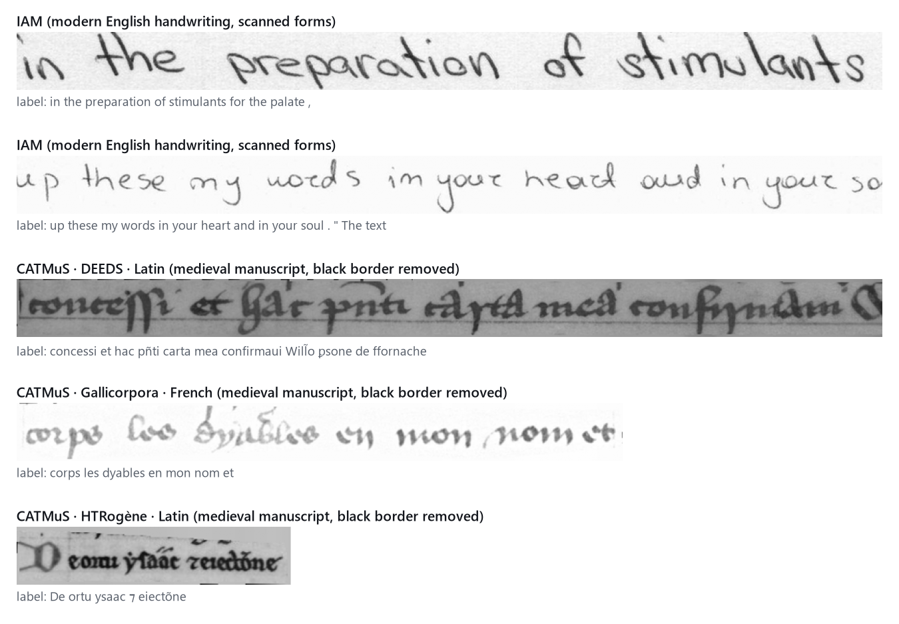
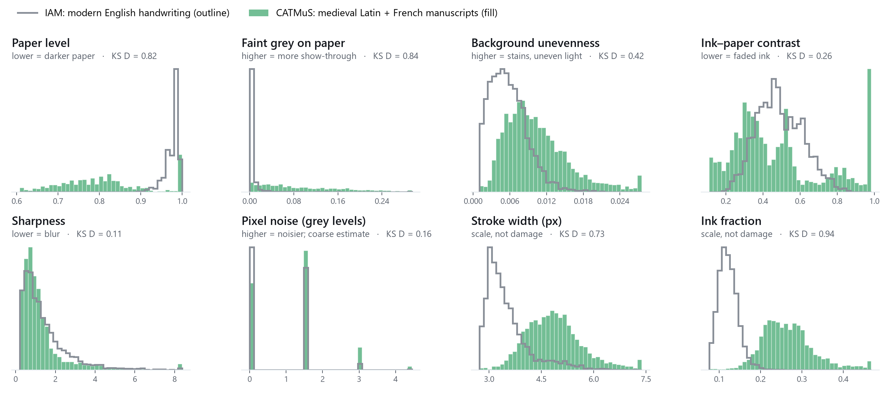
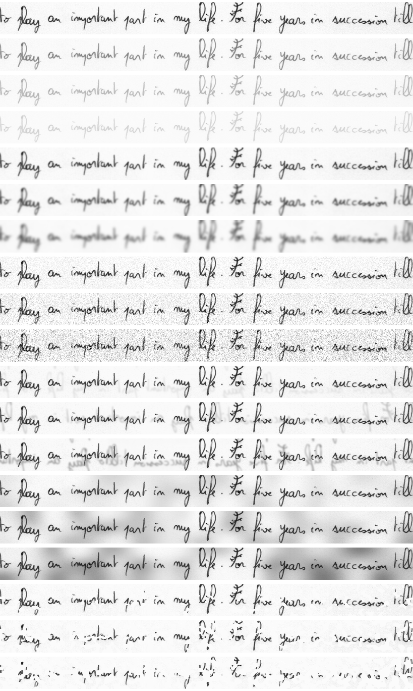
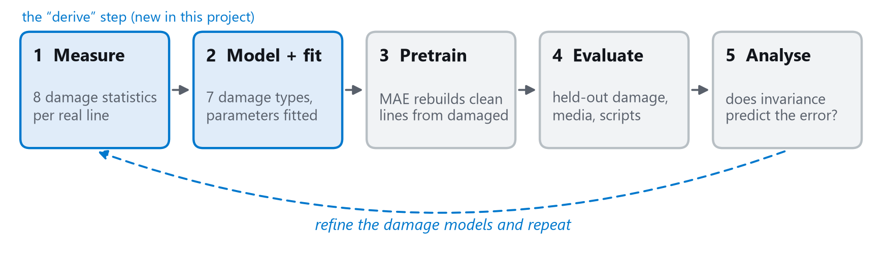

# Introduction

## Background

Handwritten text recognition (HTR) is the task of reading the characters in an
image of handwriting and producing the matching typed text. Most practical
systems work on one text line at a time: a page is first split into lines, and
a recogniser maps each line image to a character sequence. A widely used design
is the convolutional recurrent neural network (CRNN) [1], in which a
convolutional network (CNN) extracts visual features along the line, a
bidirectional LSTM models the order of characters, and connectionist temporal
classification (CTC) aligns the output with the target text without needing
the position of each character.

On clean modern handwriting such as the IAM database [2], these recognisers
are accurate. Historical documents are a different setting. Centuries-old
manuscripts, such as those collected in CATMuS Medieval [3], show faded
or corroded ink, darkened and uneven paper, ink from the reverse side showing
through, stains, and blur or noise from the scanning process. Each of these
changes the image without changing the text, and each can raise the error of a
recogniser that never saw it during training.

The usual remedy is more labelled data, that is, more line images with typed
transcriptions. For damaged historical collections this is expensive: a
transcriber needs palaeographic training, and the most damaged lines are the
slowest to transcribe. Self-supervised learning (SSL) offers a way around this.
A model first learns from unlabelled lines through a pretext task, such as
rebuilding hidden parts of an image, and is then fine-tuned on the few labelled
lines that exist [4], [5], [6]. For handwriting, recent work
shows that pixel-reconstruction methods such as masked autoencoders [7]
outperform contrastive methods [8].

Every SSL method, however, depends on a choice that is rarely examined: which
variations the model should learn to ignore. This is set through the
augmentations or corruptions applied during pretraining, and for text it is
usually a hand-picked list whose strengths are tuned by trial and error. This
project asks whether that list can instead be derived from measurements of real
damaged documents, and whether doing so helps a recogniser read them.

## Applications and Target Users

The work is aimed at people who need machine-readable text from damaged
handwritten collections but cannot afford to transcribe thousands of lines by
hand:

- **Archives, libraries and museums** that digitise manuscript collections and
  want searchable full text, not only page images.
- **Digital-humanities researchers** who build editions and corpora from
  historical sources and use HTR platforms such as Transkribus or eScriptorium,
  where a new collection usually starts with very few transcribed lines.
- **Developers of HTR tools**, who must decide which augmentations to ship for
  a new collection. A measured damage recipe replaces guesswork with a
  repeatable procedure.

The pilot results in Chapter 6 give concrete numbers for this setting. A
commercial off-the-shelf recogniser (PaddleOCR PP-OCRv6 [9]) reads clean
IAM lines with an 11.4% character error rate (CER) but medieval CATMuS lines
with 52.5% CER. A small CRNN trained on all 23,762 CATMuS training lines
reaches 20.0% CER, but with only 5% of those labels (1,188 lines) the error
rises to 33.8%. On IAM, reducing the labels from 10% to 1% raises the error
from 19.9% to 43.3%. Few labels and damaged pages together are therefore the
case where current tools fail, and it is the case this project targets.

## Scope

Phase 1 focuses on a single question: which damage should a line recogniser
learn to see through? It works on single text lines, small models that train on
one 8 GB laptop GPU, seven damage types, and two datasets in the Latin script.
Page layout analysis, large vision-language models and multilingual training
are out of scope. Transfer to an unseen script is planned as a later stretch
test; until then, all claims are limited to the Latin script.

# Problem Statement

## Statement

Text recognisers fail on damaged documents, and damaged documents are exactly
where labelled training data is scarcest. Self-supervised learning can use
unlabelled lines, but it must be told which variations to ignore, and today
that choice is a hand-picked list of corruptions re-tuned for every new
collection. This project derives the choice from the documents themselves: it
measures the main damage types on real historical lines, sets the frequency and
strength of synthetic damage from those measurements, trains with it, and tests
whether the learned invariance transfers to unseen damage, media and scripts,
and whether it predicts where recognition fails.

## Research Questions and Hypotheses

Each question is stated with the result that would show our claim to be wrong.
These rules were fixed before any experiments were run.

| | Question and claim | The claim is wrong if |
|---|---|---|
| RQ1 (H1) | Does damage derived from real pages beat plain masking and hand-picked damage when few labels exist? Claim: it lowers the error on real historical lines. | the gap is within the spread across random seeds, or hand-picked damage matches it |
| RQ2 (H2) | What transfers? Claim: the benefit shrinks with distance from what was fitted: first an unseen damage type, then a new medium, then a new script. | transfer to a new script equals or beats transfer to a new damage type |
| RQ3 (H3) | Does a model's invariance to a damage type predict how much that damage raises its error? Claim: ignoring damage that touches only the paper helps, while ignoring damage on the strokes does not (a "sign flip"). | a single relationship holds for all damage types, or there is none |

Table: Research questions, hypotheses and the result that would refute each.

# Literature Survey

## Self-Supervised Learning for Text Recognition

Penarrubia, Valero-Mas and Calvo-Zaragoza [4] review SSL for both
handwritten and scene text. They group methods into discriminative ones
(contrastive learning, distillation, clustering and others) and generative ones
(masked image modelling, inpainting), and they report that results are hard to
compare because papers use different evaluation protocols and label fractions.
They also stress that augmentations must suit text: a horizontal flip or a
random crop can destroy the reading order. The survey maps the field but gives
no procedure for choosing augmentations.

SeqCLR [10] adapted contrastive learning to text by treating a line as a
sequence of frames and contrasting matching frames across two augmented views.
LoGo-HTR [11] combines a local contrastive loss with a global
decorrelation loss, pretrains on about ten million word images, and reports
gains over earlier methods with only a fraction of the labels. Neither studies document damage.

Lacuna Reconstruction [6] pretrains on unlabelled historical lines by
masking regions and asking the model to identify the hidden content among
distractors. With only 30 labelled lines, it reduces CER from 60.4% to 23.7%,
using about 750,000 unlabelled lines. Kišš and Hradiš [5] pretrain
recognisers on unlabelled historical lines with masked-prediction and
joint-embedding objectives, then fine-tune with varying amounts of labels. Pretraining clearly beats training from scratch, but it struggles
to beat supervised transfer from a related labelled dataset. This is an
important warning: SSL is not a guaranteed gain, so a supervised baseline must
always be reported.

Garrido-Munoz and Calvo-Zaragoza [8] compare six SSL methods from three
families under one encoder and protocol on six handwriting benchmarks. Pixel
reconstruction gives the lowest error on every benchmark, which they explain by
showing that the information that separates characters lies in the
high-variance pixel directions that reconstruction must model. This result is
why our project uses reconstruction pretraining and asks *which damage* rather
than *which SSL family*.

Text-DIAE [12] is the closest earlier work. It trains an autoencoder to
undo masking, blur and noise, giving features that are robust to these
degradations for both recognition and document enhancement. The degradations
and their strengths are, however, chosen by hand, and transfer to held-out
damage types is not tested.

## Modelling Document Damage

Degradation modelling for documents has a long history. Kanungo, Haralick,
Baird and co-authors [13] proposed a statistical method for validating
degradation models against real scans: synthetic pages are accepted when their
statistics are indistinguishable from real ones. Baird [14] later reviewed
the state of the art of such models. These works targeted classical OCR on
binary printed pages and were not connected to what a deep recogniser learns to
ignore.

Modern tools generate realistic damage at scale. Augraphy [15] is a
library of ink, paper and lighting effects arranged as a pipeline that follows
the life of a document. PreP-OCR [16] trains an image restoration model
on synthetic damage, runs OCR on the restored image and corrects the output with
a language model, reporting a 63.9–70.3% reduction in character error compared
with OCR on the raw pages. In both, which damage to use and how strong it
should be is left to the user, and the goal is restoration rather than training
a recogniser that ignores the damage.

## Invariance and Robustness

Ericsson, Gouk and Hospedales [17] measure how invariant a
self-supervised model is to each augmentation and show that different
downstream tasks need different invariances. Their measure, the similarity of
features for an image and its augmented version, is the basis of the
invariance measure used in this project. Mintun, Kirillov and Xie [18]
show that, for supervised image classifiers, the similarity between training
augmentations and test corruptions predicts robustness. Both studies use
natural images; neither derives the corruptions from data or studies text.

# Research Gap and Objectives

## Research Gap

Each part of this project exists separately in earlier work. Damage models have
been fitted to scans [13], damage libraries exist [15],
degradation-invariant pretraining has been tried [12], and invariance
can be measured [17]. What is missing is the link between them:

1. **The corruptions are hand-picked.** SSL methods for text [10],
   [6], [11] choose what the model should ignore by hand and re-tune
   it for each collection. We derive it from measurements of real damage.
2. **Fitted damage was never linked to deep recognisers.** Classical
   validation [13], [14] was built for binary OCR. We connect the
   chain *measured damage → recipe → what the model ignores → error on real
   damaged lines*.
3. **No held-out tests.** Damage-style augmentation in text SSL [12] is
   not tested on damage types, media or scripts held out from training. We hold
   out whole damage types, media and scripts.
4. **Nobody checks whether the choice matters.** Damage generators
   [15], [16] leave the choice of damage to the user. We test
   whether what the model ignores predicts the error for each damage type.

## Challenges

| Challenge | Why it matters | How it is handled |
|---|---|---|
| SSL may not beat supervised training [5] | The main use of the recipe would be lost | A supervised baseline is always run; the invariance analysis is a result either way, and the recipe is also tested as augmentation |
| "You only learned your own simulator" | A model trained on synthetic damage may not read real damage | Testing is always done on real damaged lines, grouped by measured damage |
| Some damage has no exact physical model | Fading and stains cannot be written as exact formulas | Physical models where possible (show-through, capture); the rest are labelled approximate |

Table: Main challenges and how they are handled.

## Objectives

1. Build a reproducible line-recognition pipeline with strong supervised
   baselines on clean and historical data.
2. Build a per-line damage measurement tool and quantify how real historical
   lines differ from clean ones.
3. Implement damage models whose frequency and strength are derived from these
   measurements.
4. Compare masked-autoencoder pretraining with derived damage against no
   damage, plain masking, hand-picked damage and a VICReg [19] control,
   and test the derived damage as training augmentation.
5. Test transfer to a held-out damage type, a new medium and an unseen script.
6. Relate each model's invariance to each damage type to the rise in error
   caused by that damage.

# Overview of Datasets

## Description

| Dataset | Script | Size | Role | Status |
|---|---|---|---|---|
| IAM-line [2] | Latin (modern English) | 6,482 train / 976 val / 2,915 test lines; 657 writers | Clean baseline; base for synthetic damage | Processed |
| CATMuS Medieval [3] | Latin (medieval Latin, French and others) | About 195,000 lines in the current release | Real damage: measurement, pretraining, testing | Subset processed |
| IIIT-INDIC-HW-WORDS [20] | 8 Indian scripts | 872,000 word images | Optional script-transfer test | Planned |
| Muharaf [21] | Arabic | 36,311 manuscript lines (1,216 of 1,644 pages public) | Unseen-script stretch test | Planned |

Table: Datasets used and planned.

**IAM** contains modern English handwriting from 657 writers, with text taken
from the LOB corpus. We use the line-level release on Hugging Face (Teklia),
whose split is writer-independent: no writer appears in both training and test.
IAM is licensed for non-commercial research use.

**CATMuS Medieval** collects manuscripts and early printed books from the 8th
to the 16th century in about ten languages, transcribed under shared
guidelines. It is released under CC BY 4.0. Because the full release is about
22.5 GB, the pilot uses a subset: Latin and French lines from 11 projects,
giving 23,762 training, 1,243 validation and 4,022 test lines. The test lines
come from manuscripts that do not appear in training, so the test measures
generalisation to unseen manuscripts. Shards were drawn round-robin across
projects to keep the subset varied.

{width=80%}

## Data Attributes and Features

**Pre-processing.** Every line is converted to grey-scale, resized to a height
of 64 pixels with its aspect ratio kept, and paired with its transcription in
Unicode NFC form. Character sets are built from the training splits only: 79
symbols for IAM and 195 for CATMuS.

**Damage statistics.** For each line we compute eight statistics. Six track a
damage type; two (stroke width and ink fraction) mainly reflect pen size and
are treated as scale, not damage. Table 5.2 compares 3,000 sampled CATMuS lines
with IAM using the Kolmogorov–Smirnov distance D (0 means identical
distributions, 1 means completely separate).

| Statistic | What it measures | IAM median | CATMuS median | KS D |
|---|---|---|---|---|
| Paper level | Brightness of the paper (low = darker) | 0.980 | 0.804 | **0.82** |
| Faint grey on paper | Share of faintly grey paper (high = show-through) | 0.0018 | 0.0767 | **0.84** |
| Background unevenness | Patchy paper from stains or uneven light | 0.0054 | 0.0094 | 0.42 |
| Ink–paper contrast | Dark ink against paper (low = faded) | 0.478 | 0.408 | 0.26 |
| Sharpness | Edge sharpness (low = blurred) | 1.084 | 0.939 | 0.11 |
| Pixel noise | Speckle on the paper | 0.0000 | 0.0058 | 0.16 |
| Stroke width (scale) | Pen width in pixels | 3.33 | 4.81 | 0.73 |
| Ink fraction (scale) | Share of ink pixels | 0.119 | 0.260 | 0.94 |

Table: Damage statistics on IAM and CATMuS lines.

{width=100%}

Real manuscripts differ clearly from clean lines in paper level and
show-through, and much less in the other damage statistics.

**Damage types.** Seven synthetic damage types are implemented: paper tone,
show-through, stain, fade, blur, noise and ink loss. Each has three fixed test
strengths (low, medium, high). Ink loss is held out of every training recipe
and serves as the unseen damage type.

{width=50%}

# Proposed Approach and Pilot Results

## Proposed Approach

{width=100%}

The method has five steps (Figure 6.1): measure damage statistics on real
lines; fit the frequency and strength of each damage type; pretrain or train
with the derived damage; evaluate on held-out damage, media and scripts; and
analyse whether invariance predicts the error.

**Deriving the recipe.** Each damage type is first applied to clean IAM lines at
many strengths, and its statistic is measured each time, giving a response
curve from strength to statistic. A CATMuS line counts as damaged for a type if
its statistic lies outside the 5–95% range of clean IAM lines. The share of
such lines sets how often the damage is applied, and their strengths, read off
the response curve, set how strong it is. The resulting recipe (v0) applies
paper tone to 84% of lines, show-through to 89%, stain to 37%, fade to 26%,
noise to 11% and blur to 5%. The hand-picked baseline applies each type to 50%
of lines with a strength drawn uniformly from a range chosen by eye.

```python
def derive(src_stats, tgt_stats, curves):
    out = {}
    for fam in FAMILIES:
        st, d = STAT[fam], DIRECTION[STAT[fam]]
        edge = src_stats[st].quantile(0.95 if d > 0 else 0.05)  # clean band
        t = tgt_stats[st].dropna()
        hit = t[(t > edge) if d > 0 else (t < edge)]  # damaged real lines
        p = invert(curves[curves.family == fam], hit.to_numpy())
        out[fam] = dict(prob=len(hit) / len(t),  # how often
                        p_quantiles=np.quantile(p, np.linspace(0, 1, 21)))
    return out                                    # how strong
```

**Model.** The recogniser is a CRNN [1] with 7.4 million parameters: a CNN
that outputs 384 features per 4-pixel column, a bidirectional LSTM and a CTC
output. For pretraining, a masked autoencoder on the CRNN's own CNN (ConvMAE)
hides 60% of the 8-pixel vertical strips of a damaged line and learns to
rebuild the clean line. All runs share the same settings, so differences come
only from the training images.

**Invariance measure.** Each of 500 test lines is passed through the CNN clean
and with one damage added. The features are averaged along the line,
standardised using the clean lines, and compared with cosine similarity:

$$\text{invariance} = \frac{1}{N}\sum_{i=1}^{N} \cos\big(z(x_i),\, z(\tilde{x}_i)\big) \qquad (6.1)$$

where $x_i$ is a clean line, $\tilde{x}_i$ the same line with damage added, and
$z$ the standardised pooled features. A value of 1 means the damage changed
nothing inside the model.

## Pilot Results

The pilot tested four assumptions (A1 to A4), each with a pass or fail rule
written down before the runs. All results are character error rates (CER) on
the test sets; few-label results are means over two or three random seeds.

**Baselines.** A small CRNN trained on all labels beats the off-the-shelf
commercial recogniser on both datasets (Table 6.1).

| Model | IAM CER | CATMuS CER |
|---|---|---|
| PaddleOCR PP-OCRv6, off the shelf | 11.4% | 52.5% |
| CRNN, all labels | **9.8%** | **20.0%** |
| CRNN, few labels (IAM 10%, CATMuS 5%) | 19.9% | 33.8% |
| CRNN, very few labels (IAM 1%) | 43.3% | not run |

Table: Baseline character error rates on the test sets.

**A1 passes: damage hurts.** On clean IAM test lines with synthetic damage at
medium strength, four of seven types more than double the error of a
clean-trained model: ink loss (9.8% to 75.1%), noise (48.6%), paper tone
(33.1%) and blur (30.2%). On real CATMuS lines, the quarter with the faintest
ink has 1.35–1.47 times the error of the quarter with the strongest ink.

**A2 fails: only two damage statistics differ clearly.** Paper level (D = 0.82)
and show-through (D = 0.84) pass the threshold of 0.5, but three were required
(Table 5.2). Real damage in this subset is mainly a matter of paper tone and
show-through.

**A3 fails and A4 passes: pretraining did not help.** ConvMAE pretraining on
30,244 unlabelled lines (34 minutes) did not beat training from scratch in any
setting (CATMuS 5%: 33.8% scratch, 33.3% masking only, 35.0% hand-picked,
33.4% derived). Derived damage was never worse than hand-picked damage, but
only because hand-picked damage hurt. Likely reasons, not yet tested, are the
small pretraining set (Lacuna Reconstruction used about 750,000 lines), long
fine-tuning at full learning rate, and a pretext task that is too easy.

**Derived damage as augmentation.** The same recipe was then used without
pretraining, drawing fresh damage on every labelled training line at every
pass while keeping its label.

| Test CER, mean of 3 seeds | None | Hand-picked | Derived | Background filter |
|---|---|---|---|---|
| CATMuS 5%, all test lines | 33.8% | 33.6% | **31.6%** | 33.0% |
| CATMuS 5%, darkest-paper quarter | 35.6% | 34.7% | **33.0%** | 35.0% |
| CATMuS 5%, most show-through quarter | 35.7% | 35.1% | **32.9%** | 34.7% |
| CATMuS 5%, lowest-contrast quarter | 39.4% | 38.1% | **37.0%** | 38.2% |
| IAM 10%, clean test lines | 19.9% | **18.8%** | 18.9% | 19.8% |

Table: Damage used as training augmentation.

On unseen medieval manuscripts, derived damage lowers the error from 33.8% to
31.6%, about three times the seed spread, and the gain holds on the most
damaged quarters of the test set. Hand-picked damage barely changes the error,
and a filter that flattens the paper tone reaches only 33.0%, so the model gains
by learning to look past the damage rather than by having it removed. On clean
IAM lines the derived and hand-picked recipes tie, as expected, since the recipe
copies CATMuS damage that clean IAM lines do not have.

# Conclusion and Plan of Work

## Conclusion of Capstone Project Phase - 1

Phase 1 built a reproducible pipeline for IAM and CATMuS, supervised baselines
(9.8% CER on IAM and 20.0% on CATMuS), a per-line damage measurement tool,
seven damage models and a first derived recipe. The pilot checked four
assumptions against rules fixed in advance. Damage clearly hurts a clean-trained
recogniser (A1 pass). Real manuscripts differ from clean lines mainly in paper
tone and show-through (A2 fail). Reconstruction pretraining at this scale does
not beat training from scratch (A3 fail), and derived damage is never worse
than hand-picked damage (A4 pass). The strongest result is that derived damage,
used as augmentation, lowers the error on unseen medieval manuscripts from
33.8% to 31.6%, where hand-picked damage and a clean-up filter do not.

For the target users, archives and digital-humanities projects with few
transcribed lines, this suggests a practical procedure: measure a new
collection, derive the damage recipe from it, and train with that recipe,
instead of guessing augmentations by hand.

## Plan of Work for Capstone Project Phase - 2

The plan is tentative and will be confirmed with the guide.

- **E2, consistency training.** On unlabelled lines, the model is trained to
  give the same reading for a clean and a damaged view of a line. This is also
  the main test of H3, the sign-flip prediction.
- **E3, one bounded SSL retry.** Ten times more unlabelled lines, a public
  pretrained encoder and a fixed stop date, whatever the result.
- **E4, new damage.** A pair of datasets in the same script but with different
  damage, to separate the effect of damage from that of script.
- **Damage models v1.** Physically fitted damage models, real lines tagged by
  damage type, invariance measured on CATMuS, and more seeds.
- **Phase 3 stretch, script transfer.** One unseen script, such as an Indic
  script (IIIT-INDIC-HW-WORDS [20]) or Arabic manuscripts (Muharaf
  [21]), subject to access and licence.

| Period (2027) | Work |
|---|---|
| January | Damage models v1; tag real CATMuS lines; more seeds for the pilot runs |
| February | E2 consistency training; invariance on CATMuS (RQ3) |
| March | E3 bounded SSL retry; E4 same-script, different-damage pair (RQ2) |
| April | Analysis, robustness checks, paper draft |
| May | Final report, demonstration and review |

Table: Tentative timeline for Phase 2.

# References {-}

[1] B. Shi, X. Bai and C. Yao, "An end-to-end trainable neural network for image-based sequence recognition and its application to scene text recognition," *IEEE Transactions on Pattern Analysis and Machine Intelligence*, vol. 39, no. 11, pp. 2298–2304, 2017.

[2] U.-V. Marti and H. Bunke, "The IAM-database: An English sentence database for offline handwriting recognition," *International Journal on Document Analysis and Recognition*, vol. 5, pp. 39–46, 2002.

[3] T. Clérice *et al.*, "CATMuS Medieval: A multilingual large-scale cross-century dataset in Latin script for handwritten text recognition and beyond," in *Proc. ICDAR 2024*, LNCS 14806, Springer, 2024, pp. 174–194.

[4] C. Penarrubia, J. J. Valero-Mas and J. Calvo-Zaragoza, "Self-supervised learning for text recognition: A critical survey," *International Journal of Computer Vision*, 2025.

[5] M. Kišš and M. Hradiš, "Self-supervised pre-training of text recognizers," in *Proc. International Conference on Document Analysis and Recognition (ICDAR)*, 2024.

[6] N. Vogler, J. P. Allen, M. T. Miller and T. Berg-Kirkpatrick, "Lacuna reconstruction: Self-supervised pre-training for low-resource historical document transcription," in *Findings of the Association for Computational Linguistics: NAACL 2022*, 2022.

[7] K. He, X. Chen, S. Xie, Y. Li, P. Dollár and R. Girshick, "Masked autoencoders are scalable vision learners," in *Proc. IEEE/CVF CVPR*, 2022, pp. 16000–16009.

[8] C. Garrido-Munoz and J. Calvo-Zaragoza, "Handwritten text recognition lives in the high-pixel variance subspace," arXiv:2609.35473, 2026.

[9] PaddlePaddle Authors, "PaddleOCR (PP-OCR series)," GitHub repository. [Online]. Available: https://github.com/PaddlePaddle/PaddleOCR

[10] A. Aberdam, R. Litman, S. Tsiper, O. Anschel, R. Slossberg, S. Mazor, R. Manmatha and P. Perona, "Sequence-to-sequence contrastive learning for text recognition," in *Proc. IEEE/CVF CVPR*, 2021.

[11] Mitra, Mondal and C. V. Jawahar, "Learning beyond labels: Self-supervised handwritten text recognition," in *Proc. IEEE/CVF WACV*, 2026, pp. 6653–6663.

[12] M. A. Souibgui, S. Biswas, A. Mafla, A. F. Biten, A. Fornés, Y. Kessentini, J. Lladós, L. Gomez and D. Karatzas, "Text-DIAE: A self-supervised degradation invariant autoencoder for text recognition and document enhancement," in *Proc. AAAI Conference on Artificial Intelligence*, 2023.

[13] T. Kanungo, R. M. Haralick, H. S. Baird, W. Stuetzle and D. Madigan, "A statistical, nonparametric methodology for document degradation model validation," *IEEE Transactions on Pattern Analysis and Machine Intelligence*, vol. 22, no. 11, pp. 1209–1223, 2000.

[14] H. S. Baird, "The state of the art of document image degradation modelling," in *Digital Document Processing*, B. B. Chaudhuri, Ed. London: Springer, 2007, pp. 261–279.

[15] A. Groleau, K. W. Chee, S. Larson, S. Maini and J. Boarman, "Augraphy: A data augmentation library for document images," in *Proc. ICDAR 2023*; arXiv:2208.14558.

[16] Guan, Lin, Xu, Liu, Zhao, Fan, Xu and Greene, "PreP-OCR: A complete pipeline for document image restoration and enhanced OCR accuracy," in *Proc. Annual Meeting of the Association for Computational Linguistics (ACL)*, 2025.

[17] L. Ericsson, H. Gouk and T. M. Hospedales, "Why do self-supervised models transfer? On the impact of invariance on downstream tasks," in *Proc. British Machine Vision Conference (BMVC)*, 2022.

[18] E. Mintun, A. Kirillov and S. Xie, "On interaction between augmentations and corruptions in natural corruption robustness," in *Advances in Neural Information Processing Systems (NeurIPS)*, 2021.

[19] A. Bardes, J. Ponce and Y. LeCun, "VICReg: Variance-invariance-covariance regularization for self-supervised learning," in *Proc. International Conference on Learning Representations (ICLR)*, 2022.

[20] S. Gongidi and C. V. Jawahar, "IIIT-INDIC-HW-WORDS: A dataset for Indic handwritten text recognition," in *Proc. ICDAR 2021*, 2021.

[21] M. Saeed *et al.*, "Muharaf: Manuscripts of handwritten Arabic dataset for cursive text recognition," in *NeurIPS 2024 Datasets and Benchmarks Track*, 2024.

# Appendix A: Definitions, Acronyms and Abbreviations {-}

| Term | Meaning |
|---|---|
| Augmentation | Changing a training image (here, adding synthetic damage) while keeping its label |
| CER | Character error rate: edit distance between prediction and true text, divided by the length of the true text |
| ConvMAE | Masked autoencoder built on the CRNN's own CNN, used for pretraining in this project |
| CRNN | Convolutional recurrent neural network: CNN, then BiLSTM, then CTC |
| CTC | Connectionist temporal classification; a loss that aligns a sequence of predictions with the target text |
| Derived recipe | Frequency and strength of each damage type, set from measurements of real lines |
| HTR | Handwritten text recognition |
| Invariance | How little a model's internal features change when a damage is added (1 = no change) |
| KS distance (D) | Kolmogorov–Smirnov statistic: largest gap between two cumulative distributions (0 = same, 1 = separate) |
| MAE | Masked autoencoder: hides parts of an image and learns to rebuild them |
| Seed | The starting value of the random number generator; repeating a run with different seeds shows how much results vary by chance |
| Show-through | Ink from the reverse side of the page visible through the paper |
| SSL | Self-supervised learning: learning from data without labels through a pretext task |
